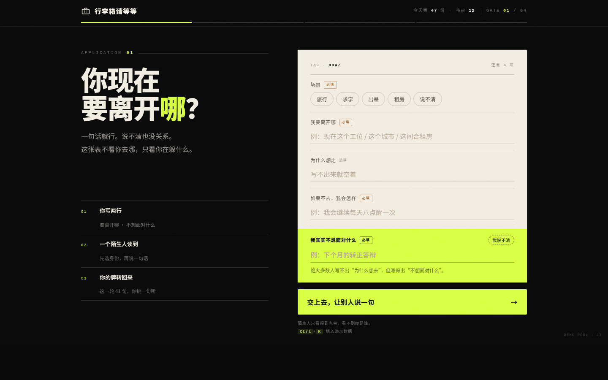
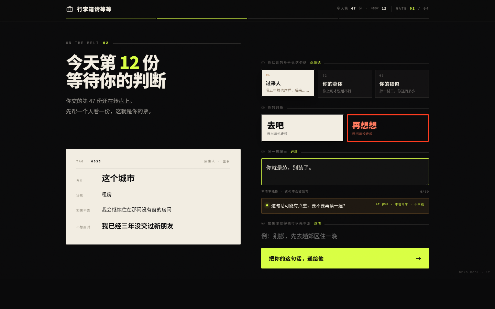
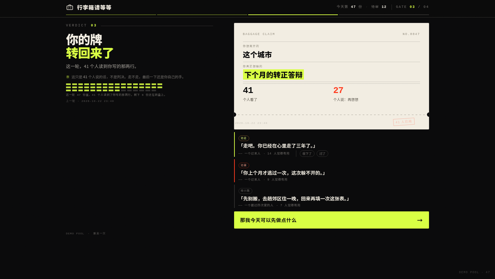

# 行李箱请等等

把「我要走」这个念头，交给陌生人审一遍。如果被劝退，还你一条今天能走的路。

一个四页单文件 Web Demo：**交申请 → 审别人 → 看判决 → 换一条**。
零依赖、零请求、断网双击就能跑。

---

## 在线地址

| | |
|---|---|
| 演示（默认静态） | https://niuyongtaigr-oss.github.io/luggage-please-wait/ |
| 在线版（真实池子） | https://niuyongtaigr-oss.github.io/luggage-please-wait/?live=1 |
| 仓库 | https://github.com/niuyongtaigr-oss/luggage-please-wait |

---

## 怎么跑

```bash
# 1. 本地演示（最简单）
双击 index.html

# 2. 必须在有动画的情况下跑
open index.html

# 3. 拍照 / 救场（关掉全部动画）
index.html?static=1

# 4. 投影仪发灰（配色不变，提对比）
index.html?proj=1

# 5. 排练直达某一页
index.html#review  /  #verdict  /  #swap

# 6. 在线模式（需要先填 config.js，见 supabase/README.md）
index.html?live=1
```

**在线模式已实测通过**（项目 `yxsjtjsbawnaonpvyowk`）：真实序号、不抽到自己、重复提交被唯一索引拦、自我审批被拒、判决按去重人数聚合。

**在线模式连不上会自动回落静态轨，顶栏角标会告诉你现在是哪个**：`在线 · 真实池子` / `离线 · 演示数据`。
没填 `config.js` 时，`?live=1` 也是纯静态，不出错、不发请求。

演示时只用三个键：**`Ctrl/⌘ + K`** 一键填表，**`R`** 刷新判决书，**Esc** 关面板。

---

## 文件

```
/
├── index.html      结构 + 样式 + 全部交互         （A 维护）
├── data.js         申请池 / 三类声音 / 路线卡 / 词库（B 维护）
├── config.js       Supabase 的 URL 和 anon key（填了才启用在线模式）
├── api.js          Supabase 适配层，纯 fetch 零依赖
├── supabase/
│   ├── schema.sql  建表 + 唯一索引 + 6 个 RPC（可重复执行，自带自愈）
│   └── README.md   接入步骤 + 运维 SQL（重置 / 去重 / 体检 / 重建）
├── docs/
│   ├── 06-路演逐字稿.md  3 分钟稿 / 100 秒走位 / 手卡 / 预判问答
│   ├── 05-发布流程.md  建仓 → Pages → 打 tag 的完整命令
│   ├── 01-需求文档.md
│   ├── 02-技术方案.md
│   └── 03-任务拆分.md
├── tools/
│   └── selftest.sh 端到端走位自测，push 前跑一次
└── README.md
```

**`index.html` 和 `data.js` 必须放在同一个文件夹。** 少一个，页面会直接告诉你缺哪个。

---

## 改文案只动 data.js

```js
window.DATA = {
  meta:         { poolSize, reviewed, think, reviewNo, demoIndex, roundLabel },
  applications: [ { scene, leaving, ifNot, avoid } ],   // 7 条
  verdict:      { quotes: [ { tone, by, text } ] },     // 劝走 / 劝留 / 给小路
  routes:       [ { mood, name, dist, thing, verified, worth, source } ],
  guard:        { hint, note, words: { 羞辱, 说教, 嘲讽 } },
  empty:        { hudZero, sealZero, subZero, capEmpty, capNoReaders, ... }
};
```

三条规矩：**不放逻辑、数字只在 `meta`、数组长度随便改。**

`empty` 是空状态文案——池子空、还没人读过你的时候页面说什么。
**宁可说人话（「今天刚开始」），也不要显示 0，更不要编一个好看的假数。**

---

## 自测

```bash
bash tools/selftest.sh
# ✓ 全部通过（9 组断言）
```

推之前跑一次，全绿再 push。

---

## 200 字说明（提交用）

> 「行李箱请等等」是一个四页单文件 Web Demo：交申请、审别人、看判决、换一条。前端零依赖，状态机四页，数据与文案分离在 data.js，部署在 GitHub Pages，断网可用。核心设计约束：审批理由必须由人填写，AI 不做作者。
>
> 开发使用 Kiro：先以 Spec 驱动写 requirements（每条用户故事附 EARS 验收标准）与 design（三条硬约束：理由人工填写、AI 仅做护栏、匹配规则写死），再按 tasks 依赖顺序生成实现；现场以 Supervised 模式迭代护栏词库与路线卡模块。产品内 AI 仅一处：理由命中羞辱或说教模式时给出提示，不拦截、不代写。

---

## 截图

| 桌面 | 手机 |
|---|---|
|  |  |
|  |  |
|  |  |

> 全部为纯 CSS 渲染，无一处图片素材。生成方式：`index.html?static=1#apply`

## 换仓库 / 换 Supabase

**换 Git 仓库**：代码一行都不用改（全是相对路径）。要改的是 remote、文档里 11 处地址、Pages 开关。
步骤与五个坑见 [`docs/05-发布流程.md`](docs/05-发布流程.md) §六点半。

## 换 Supabase 项目

**只改一个地方**：`config.js` 里的 URL 和 key，两个值必须成对换（来自同一个项目）。

**但新项目必须整段跑一遍 `supabase/schema.sql`** —— 表、函数、权限都在那个库里，不会跟着 config 走。

三个换库后一定会遇到的现象，以及**演示前必跑的清库 SQL**，都写在
[`supabase/README.md`](supabase/README.md)（运维手册）里。

## 三条硬约束

1. **审批理由只能由人写。** 代码里不存在对理由正文的任何模型调用。
2. **AI 只做护栏。** 命中词库只提示，不拦截、不排序、不评分。
3. **匹配规则写死。** 同场景优先 → 全池兜底，不交给模型判断，保证演示可预测。

> 这个产品里，AI 不写字。AI 只在你准备伤人的时候，轻轻碰一下你的手。
